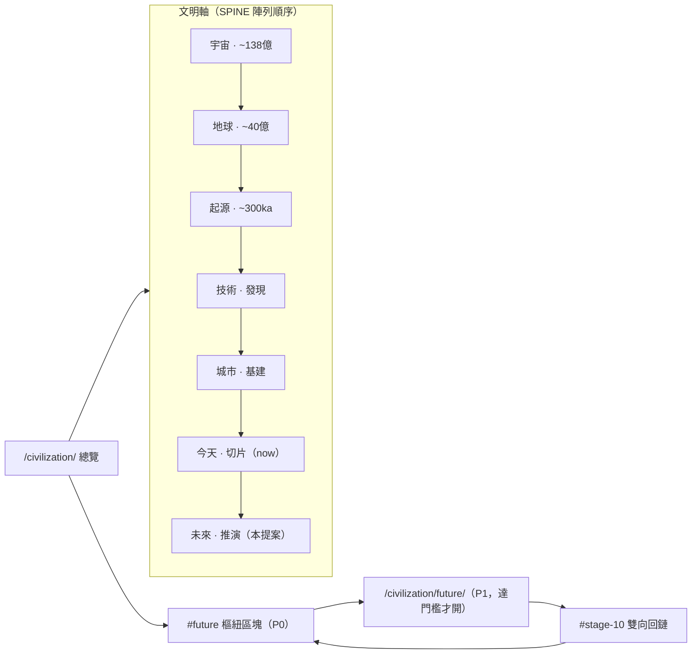

# 文明軸未來層：架構與主線管道研究

**日期：** 2026-10-19
**作者：** GLM（CloudAgent 研究軌）
**性質：** 只讀研究。本文件只提案，不改任何渲染器、資料或路由。
**對齊：** `shared/civilization/SCHEMA.md` · `shared/civilization/contract.ts` · `spine.ts` · `patterns.ts` · `cases.ts` · `questions.ts` · `lineFilter.ts` · `slices.ts` · `chronicle.ts` · `shared/civilizationPage.ts` · `functions/civilization/[[path]].ts` · `tests/civContract.test.ts` · `tests/civCases.test.ts` · `tests/lineFilter.test.ts` · `docs/slice-near-bridge.md` · `docs/CIVILIZATION-IMAGE-LAYOUT-BRIEF-2026-10-17.md`
**約束：** 書面漢語；墨色 `#161c24` 與紙感 `#f7f1e6` 不換皮；不涉敏感政治；人群不作高下比較；危機不寫成聳動文案。

---

## 0. 結論先行

1. **未來層可以主線化，且不必先開路由。** 沿用科技頁與城市頁的成頁路徑：先以總覽樞紐區塊（`#future`）與軸上末端節點落地，資料先行、錨點先行；達到厚頁字數門檻後，才開 `/civilization/future/` 一條新路由並進網站地圖。`spine.ts` 的註釋已寫明「新節點即新物件」，在 `SPINE` 陣列末端追加一筆即完成軸位擴充，不必改 `renderSpineAxis`。
2. **資料契約走「新型別」而非擴充舊契約。** `CivLine` 四線閉集、`CivCard` 的既有錨點正則、`ReadingBlock` 的欄位，三者在 P0 都有測試護欄，一律不動。未來節點不是先例：它沒有已發生的界定事件，也沒有可指認的機制句依據，硬把它塞進先例契約會把證據規則拉鬆。新增 `FutureCard` 型別與 `futureIssues()` 驗收函數，四線仍作觀察鏡，不加第五線。
3. **層級（LEVELS）是資料欄位，不是軸節點。** 以 `horizon` 欄位分近／中／遠三段（年份一律「約」），與切片的今／近／遠同一語彙，不為每段另開路由或軸節點。
4. **危機寫「中斷條件＋可核對的檢查點」，不寫倒數日。** `countdown` 只掛公共機構已公布的檢查窗口或監測週期，一律標「約」，不作動員句，不作單一機構的預言。
5. **stage-10 原文不重寫。** `#stage-N` 錨點是 P0 資產（三張模式卡、案例與問題索引都掛在其上）。未來層以雙向回鏈接駁 stage-10，方式同科技頁的 `chronicle?: number` 交叉連結，歷史頁零改寫。
6. **主線管道三軌分工不變。** Research 擁資料與來源，Art 擁圖槽（沿用 `civ-future-*` 命名），CloudAgent 擁契約、測試、路由與網站地圖接線。每批二至三張卡，`futureIssues()` 回傳空陣列、紅線掃描乾淨、契約測試全綠，三者齊備才可合併。

---

## 1. 現況與 P0 護欄盤點

| P0 契約 | 所在 | 驗收 | 對未來層的含義 |
|---------|------|------|----------------|
| 四線閉集 能量／信息／制度／貨幣 | `contract.ts` `CIV_LINES` | `civContract.test.ts`「keeps CivLine a closed four-line set」 | 未來卡照用四線作觀察鏡；度量等主題詞只進卡題，不進線集合 |
| 共同深讀形狀 `CivReadingShape` | `contract.ts` | 同上「assigns reading blocks and milestone blocks to one shape」 | 未來卡保留產物／推動力欄位，共用詞彙不另起一套 |
| 模式卡錨點綁既有編年 | `PATTERN_ANCHOR = ^/civilization/chronicle/#stage-\d+$` | `civCardIssues` 空陣列 | 未來節點不可借用模式卡錨點規則；先例與推演分開治理 |
| 不為卡片開路由、渲染器不按 id 分支 | `SCHEMA.md`；測試掃 `blocks.ts`/`chronicle.ts` 不含卡片 id | 路由表不得含卡片 id | 未來卡同樣只進資料陣列；`future.ts` 渲染器不按 id 分支 |
| 案例相關連結白名單 | `cases.ts` `CASE_RELATED` | `caseIssues` 空陣列 | 要讓案例連向未來錨，須在同一 PR 內擴白名單並同步測試 |
| 問題索引 href 白名單 | `questions.ts` `questionHrefAllowed` | `questionIndexIssues` 空陣列；8–12 條 | 未來錨入索引前，白名單須先擴；條數有上限，加一條須換一條 |
| 四線篩選只認 `data-lines` | `lineFilter.ts` + `public/columns.js`（頁面級掃描） | `lineFilter.test.ts` | 未來卡的 `lines` 全屬四線閉集，帶 `data-lines` 即自然參與篩選，指令碼零改動 |
| 路由閉集 | `functions/civilization/[[path]].ts` `PAGES` | 測試掃路由表；薄層不進網站地圖 | 新路由只在厚頁門檻達標後加一個鍵；`civilizationPublicPaths()` 條件式收錄 |
| 紅線掃描 | `civContract.test.ts` `REDLINE` + `heritageBlocked` | 全頁 HTML 過掃 | 未來層文案同守紅線；危機題材只用中性詞 |
| 視覺不換皮 | `src/App.css` 含 `#161c24`、`.pattern-card` 紙卡 | CSS 斷言 | 未來卡復用 `.civ-block` 紙卡骨架，只增 `.future-card` 一個類名 |
| 厚頁字數門檻 | `CHRONICLE_MIN_CHARS = 1200` 等同構常數 | `*Indexable()` | 未來頁未達門檻前維持 `noindex`，不進 sitemap |

---

## 2. IA：未來層掛在軸上哪裡

### 2.1 軸位

軸的現有順序是 宇宙 → 地球 → 起源 → 技術 → 城市 → 今天（`now: true`，連 `#slice`）。今天是「現在」的落點，未來層是其右側的推演段，不是「今天」的替代。`renderSpineAxis` 對普通節點與 `now` 節點已有既定樣式，追加普通節點無需改渲染器。

```ts
// spine.ts 提案 diff（P0，資料追加）
{
  id: 'future',
  label: '未來',
  year: '推演',
  href: '#future',            // P0：總覽樞紐錨
  // P1 厚頁上線後改為： href: '/civilization/future/'
},
```

### 2.2 樞紐區塊（P0）與厚頁（P1）

總覽現有渲染順序是：軸帶 → 深時間卡 → 問題索引 → 編年階段格 → 導語文章。未來樞紐區塊放在編年階段格之後、導語文章之前，閱讀順序即「深時間 → 十階段 → 未來」，與「過去與現在已存在、未來缺席」的現況正好補齊。樞紐區塊由 `future.ts` 的 `renderFutureBoard()` 提供，`civilizationPage.ts` 插入一行，與當年 `renderPatternBoard` 的接入同構。

### 2.3 IA 圖



ASCII 對照：

```
/civilization/（總覽）
 ├─ 軸帶（SPINE）：宇宙→地球→起源→技術→城市→今天→【未來（新增）】
 ├─ 今日落點 / 近層橋 / 問題索引        ← 現況不動
 ├─ 深時間卡（宇宙、地球、起源）          ← 現況不動
 ├─ 編年階段格（#stage-1..10 + 四線篩選）← 現況不動
 ├─ #future 未來樞紐區塊                 ← P0 新增（總覽內錨，不開路由）
 │    ├─ 近段卡 ×N ─ 中段卡 ×N ─ 遠段卡 ×N（data-lines 參與四線篩選）
 │    └─ 每卡回鏈：一張模式卡 + 一個既有階段錨 + 問題索引
 └─ 導語文章 / 三大文明層                 ← 現況不動

P1：/civilization/future/ 厚頁（PAGES 增一鍵，達字數門檻才 indexable）
```

---

## 3. 資料契約：新型別 vs 擴充舊契約

### 3.1 三個「不擴」的理由

| 舊契約 | 不擴充的理由 |
|--------|--------------|
| `CivLine` 四線閉集 | 閉集是 P0 測試釘死的前提；`lineFilter` 的 `data-lines` 屬性、篩選指令碼、四線總結都建立在四項之上。未來層加第五線等於重寫整條篩選軸，且「未來」是時間段，不是基礎設施類別，語彙不對位。 |
| `CivCard`（模式卡） | 模式卡的本義是「可調用的機制掛在既有先例上」：`anchor` 必須是已上線的 `#stage-N`，`sources` 恰有一條 `supports: 'mechanism'`。未來節點兩樣都給不出——它沒有已發生的界定事件，機制句無從指認主要依據。硬擴 `PATTERN_ANCHOR` 會把「先例」的證據規則拉鬆。 |
| `ReadingBlock`／`blocks.ts` | 共用深讀塊的欄位語義是已發生的產物與推動力。cases 已示範正確做法：`renderCase` 包住 `renderReadingBlock`，外層自帶章節與標題，不改 `blocks.ts` 一行。未來卡照此辦理，`blocks.ts` 零改動。 |

### 3.2 新型別 `FutureCard`

新檔 `shared/civilization/future.ts`，單一陣列 `FUTURE_CARDS`，渲染器只讀陣列、不按 id 分支——與 `PATTERN_CARDS`、`CASE_STUDIES` 同一治理方式。

| 欄位 | 約束 | 與既有形狀的對應 |
|------|------|------------------|
| `id` | 穩定英文 slug；頁內錨 `#future-{id}` | 同模式卡、案例 |
| `kind` | `'領域' \| '物種' \| '存續'`（domain／species／survival） | 新增；決定卡面小標 |
| `title` | 卡題，主題詞（如推演、形態）入題不入線 | 同模式卡 |
| `lines` | `CivLine` 一至四項，不可重複 | 同模式卡；四線作觀察鏡 |
| `horizon` | `'近' \| '中' \| '遠'`。近＝約十年內；中＝約一代人；遠＝約半世紀以上。年份一律「約」 | 與切片今／近／遠同一語彙 |
| `basis` | 不多於 80 字。今天已在場、可核對的條件 | 對應 `problem`，但指向現況而非難題 |
| `basisDetail` | 現況段落 | 對應 `eventDetail` |
| `condition` | 不多於 120 字。換情境仍成立的條件句 | 對應 `mechanism`，語義由「已如何運作」改為「若條件在場則如何」 |
| `reversal` | 不多於 80 字。中斷或逆轉條件 | 對應 `boundary`；物種卡必寫「形態，不是優劣」一句 |
| `watch` | 不多於 28 字。今日可問，不是動員句 | 對應 `ask` |
| `countdown` | 僅 `kind='存續'` 必填：`{ checkpoint; window; owner }`。`checkpoint` 須是公共機構已公布的檢查窗口或監測週期；`window` 標「約」；`owner` 寫機構職責範圍 | 新增；危機卡專用 |
| `products` / `drivers` | 至少各一項，沿用 `CivProduct`／`CivDriver` | 同 `CivReadingShape` |
| `stakes` | 一句條件式利害 | 對應 `impact`；由「溫和影響」改為「若中斷則失去什麼」 |
| `sources` | 至少四條 `https`，恰一條 `supports: 'basis'` | 同模式卡；依據詞由機制改為現況 |
| `related` | 至少四條：一張模式卡、一個既有階段錨、問題索引 | 同案例規則 |

### 3.3 驗收函數 `futureIssues()`

與 `civCardIssues`、`caseIssues`、`questionIndexIssues` 同構，回傳空陣列才算通過：

| 門 | 規則 |
|----|------|
| `id` | slug 正則 |
| `kind` / `horizon` / `lines` | 枚舉與閉集校驗；`lines` 不可重複、不可混入別的命名空間 |
| 字數 | `basis ≤ 80`、`condition ≤ 120`、`reversal ≤ 80`、`watch ≤ 28` |
| `countdown` | 存續卡必填；`checkpoint` 與 `owner` 非空；`window` 含「約」；禁配對倒數式文案（如「只剩」字樣） |
| 文案 | `watch` 不得為動員句；不得出現人群比較詞（沿用 `/誰最\|排名\|偉人\|第一人\|最偉大/` 一類掃描） |
| 來源 | `≥ 4`、去重、`https`、恰一條 `supports: 'basis'`；機構頁優先（政府間組織、國家級機構、公共博物館），不引商業預測內容 |
| `related` | 白名單校驗；至少一張模式卡、一個既有階段錨、恰一條問題索引 |

### 3.4 週邊契約 diff（何時改、改什麼）

| 檔案 | P0 diff | P1 diff |
|------|---------|----------|
| `spine.ts` | `SPINE` 末端追加 `future` 節點（`href: '#future'`） | `href` 改 `/civilization/future/`；可選增 `board` 進深時間式卡格 |
| `civilizationPage.ts` | 總覽插入 `renderFutureBoard()` 一行 | 新增 `renderFuturePage()`，與其他長頁同構（crumb、`shell`、`renderSliceReturns('future')`） |
| `functions/civilization/[[path]].ts` | 不改 | `PAGES` 增 `future` 一鍵；`civilizationPublicPaths()` 條件式收錄（未達字數門檻不進 sitemap） |
| `questions.ts` | 不改（未來錨未入白名單，問題索引先不指未來） | `questionHrefAllowed` 增 `/civilization/#future-{id}` 與 `/civilization/future/#future-{id}` 兩式；條數上限 8–12 不變，加一條換一條 |
| `cases.ts` | 不改 | `CASE_RELATED` 增未來錨兩式，讓案例可前向連結 |
| `slices.ts` | 不改 | `SliceAxis` 增 `'future'`；近層先例仍指過去，未來錨用於回鏈段 |
| `blocks.ts` / `contract.ts` / `lineFilter.ts` | 零改動 | 零改動 |
| `public/columns.js` | 零改動（未來卡帶 `data-lines`，頁面級掃描自然涵蓋） | 零改動 |
| `src/App.css` | 只增 `.future-card` 類名，復用 `.civ-block` 紙卡與 `#161c24`/`#f7f1e6` | 同左 |

### 3.5 新路由的正當性門檻

本倉的既定模式是「錨點先行，路由在後」：模式卡、案例、問題索引全部掛既有頁面的 `#` 錨，不開網址。新路由只在三項同時成立時才正當：

1. 內容達厚頁字數門檻（同構於 `CHRONICLE_MIN_CHARS = 1200`），否則維持 `noindex` 的薄層本身就是反模式；
2. 掛既有頁錨會把宿主頁撐破（未來層三段 × 多卡 × 存續專篇的體量，與編年十階段同級，總覽容不下）；
3. 契約與驗收測試已先行（`futureIssues` 空陣列、紅線掃描、路由測試同步更新）。

反之，只要一張卡能掛在既有錨下（樞紐區塊 `#future-{id}`），就先不開路由。這正是 P0 與 P1 的分界。

---

## 4. 主線管道（MAINLINE）

### 4.1 檔案與資料擁有權

| 資產 | 位置 | 擁有軌 |
|------|------|--------|
| 未來卡資料與來源 | `shared/civilization/future.ts` | Research 撰寫；CloudAgent 只搬運不改寫 |
| 契約與驗收函數 | `future.ts` 內 `futureIssues()` | CloudAgent 與 Research 共簽，一次定稿後不逐卡改 |
| 契約測試 | `tests/civFuture.test.ts`（新增）；`civContract.test.ts` 只在 P1 擴白名單斷言 | CloudAgent |
| 圖槽素材 | `public/static/civilization/civ-future-{id}-{400w/640w/1280w}.webp`，命名沿用圖像落位簡報 | Art |
| 圖槽 DOM 與降級 | 未來卡沿用紙感「產」印缺圖降級（`onerror` 隱藏、紙印留存） | CloudAgent 接線，Art 供圖 |
| 路由與 sitemap | `functions/civilization/[[path]].ts`、`civilizationPublicPaths()` | CloudAgent |
| 研究簡報 | `docs/research/` | Research |

### 4.2 批次尺寸

先例：模式卡首批三張、案例首批兩篇、近層橋首批五條。未來層照此節奏，寧小勿大：

| 批次 | 內容 | 張數 |
|------|------|------|
| 一（P0） | 領域卡：能量、信息、制度與貨幣各一，與首批模式卡的線位對齊，方便雙向互鏈 | 3 |
| 二（P1） | 物種卡：工具形態類題材，每張寫明「形態，不是優劣」 | 2 |
| 三（P1） | 存續卡：氣候窗口、疫病監測一類公共機構題材，附 `countdown` | 2 |
| 四（P2） | 各段補厚；遠段卡從缺圖紙印開始，Art 依槽位表補圖 | 2–3 |

每批一個 PR、一個契約測試檔的增量；單批不得同時動契約與大量內容（契約 PR 先行、內容 PR 後至）。

### 4.3 驗收門（合併前全綠）

1. `futureIssues()` 對該批每張卡回傳空陣列；
2. `tests/civFuture.test.ts` 通過；`civContract`、`civCases`、`lineFilter`、`civilization` 既有測試零回歸；
3. 紅線掃描：頁面 HTML 與卡文過 `REDLINE` 與 `heritageBlocked`；
4. 視覺：`.future-card` 斷言含 `#161c24`／`#f7f1e6` 紙卡；不加任何腳本（維持零廣告腳本前提）；
5. 路由與 sitemap：P0 批次斷言 `PAGES` 與 `civilizationPublicPaths()` 不含 `future`；P1 批次斷言反向且字數門檻已達；
6. 無腳本降級：未來卡在未執行指令碼時全部可讀；四線篩選對未來卡的收合與空匹配說明句行為與模式卡一致；
7. `prefers-reduced-motion` 與 `civ-reveal` 行為不因新區塊改變。

### 4.4 RACI 與週節奏

RACI（R 執行、A 最終負責、C 諮詢、I 知會；A 統一為人類擁有人）：

| 工作 | Research | Art | CloudAgent | 擁有人 |
|------|----------|-----|------------|--------|
| 週簡報與選題 | R | I | C | A |
| 未來卡資料與來源 | R | I（題材知會） | C（契約校驗） | A |
| 契約與測試 | C | — | R | A |
| 圖槽素材 | C（題材） | R | I | A |
| 圖槽 DOM 接線與降級 | I | C | R | A |
| 路由、sitemap、PR | I | I | R | A |
| 紅線與合規複核 | C | C | R | A |

週節奏（建議，與現有 Cursor 批次脈絡對齊）：

| 日 | 動作 | 交接物 |
|----|------|--------|
| 週一 | Research 交週簡報＋該批卡草稿（含來源） | `docs/research/` 簡報；`future.ts` 資料草稿分支 |
| 週二 | CloudAgent 開契約 PR（若有契約增量）＋本地測試 | 契約/測試 draft PR |
| 週三 | Research 補齊來源並自檢紅線；CloudAgent 跑 `futureIssues` 回報缺口 | 缺口清單 |
| 週四 | Art 交該批圖槽（缺圖照走，紙印先行） | `public/static/civilization/civ-future-*` |
| 週五 | CloudAgent 接線、全量回歸、更新 draft PR 交人類複核 | 待審 PR |

缺圖不是阻塞項：卡面以紙感「產」印佔位先行，Art 補圖後由 CloudAgent 一行接入——這是圖像落位簡報「唔等 Art 完稿先開槽」的既定原則。

---

## 5. stage-10 遷移路徑

`#stage-10`（當代／近未來，約 2000 年代至今）是已上線的現在段敘事，其錨點被模式卡、案例與問題索引間接依賴。遷移原則是「不重寫歷史頁，只加前向接駁」：

1. **不改** `chronicle.ts` 的階段名、里程碑、prose 與 `#stage-10` 錨點；不重排十階段編號（`#stage-N` 為穩定資產）。
2. **P0**：`future.ts` 每張卡的 `related` 含一個既有階段錨；領域卡批次優先連 `#stage-9`、`#stage-10`（信息革命、當代），形成「現在段 → 未來層」的單向橋。
3. **P0 末**：`spine.ts` 追加 `future` 節點；總覽軸帶上「今天 → 未來」相鄰可見，stage-10 的現在段自然成為未來層的最近先例。
4. **P1**：未來厚頁上線，頁首交駁段連回 `#stage-10` 與 `#slice`，方式同科技頁 `chronicle?: number` 交叉連結；`questionHrefAllowed` 與 `CASE_RELATED` 擴白名單，問題索引與案例可前向指向未來錨。
5. **P1 末**：切片 `SliceAxis` 增 `'future'`，未來頁底部用 `renderSliceReturns('future')` 列出今日可問，回鏈首頁 `#near-{主題 id}`——近層橋的雙向規則（兩端一起寫）照舊。
6. **不建議**：把 stage-10 改名或收窄為「當代」、把未來內容寫進 stage-10 prose、或為未來層重編十一階段。三者都會改動已上線敘事與穩定錨點。

---

## 6. P0／P1／P2 建造切片

| 切片 | 內容 | 交付 | 護欄 |
|------|------|------|------|
| **P0-1 契約先行** | `future.ts` 骨架：`FutureCard` 型別、`futureIssues()`、空陣列、`renderFutureCard()` 包 `renderReadingBlock` | 契約 PR（零內容） | 測試先行；`blocks.ts` 零改動 |
| **P0-2 首批領域卡** | 能量、信息、制度與貨幣三張領域卡；`renderFutureBoard()` 接入總覽；`spine.ts` 追加節點 | 內容 PR | `futureIssues` 空；紅線綠；路由與 sitemap 斷言不含 `future` |
| **P0-3 篩選與降級** | 未來卡帶 `data-lines`；驗證四線篩選、空匹配說明句、無腳本可讀、紙印降級 | 接線 PR | `lineFilter.test.ts` 增未來卡斷言；`columns.js` 零改動 |
| **P1-1 厚頁與路由** | 字數達門檻後開 `/civilization/future/`；`PAGES` 增鍵；sitemap 條件收錄；stage-10 雙向交駁 | 路由 PR | `civilizationPublicPaths()` 斷言；`renderSliceReturns('future')` |
| **P1-2 物種卡批次** | 兩張物種卡（形態題材） | 內容 PR | 每張必寫「形態，不是優劣」 |
| **P1-3 存續卡批次** | 兩張存續卡附 `countdown` | 內容 PR | countdown 門：公共檢查點、「約」窗口、禁倒數式文案 |
| **P1-4 白名單擴充** | `questionHrefAllowed`、`CASE_RELATED`、`SliceAxis` 三處同步擴，加一條換一條 | 契約 PR | 三個測試檔同步；條數上限不變 |
| **P2-1 補厚與補圖** | 遠段卡補厚；Art 依槽位表補 `civ-future-*` 圖 | 逐批 PR | 缺圖不阻塞，紙印先行 |
| **P2-2 深時間式卡** | `future` 節點可選增 `board`，未來層以一枚深時間式卡進總覽卡格 | 接線 PR | 復用 `deep-time-card` 版面，不換皮 |

---

## 7. 反模式

1. **第五條線**：把「未來」「生存」寫進 `CivLine`。閉集一破，篩選、四線總結與全部既有測試連帶重寫；時間段不是基礎設施類別。
2. **重編歷史**：為未來層重排 `#stage-N`、改 stage-10 名稱或收窄其年代。錨點是穩定資產，模式卡與案例都掛在其上。
3. **借用先例契約**：擴 `PATTERN_ANCHOR` 讓模式卡掛未來錨，或讓 `FutureCard` 偽裝成 `CivCard`。先例與推演的證據規則必須分治。
4. **路由先行**：未達字數門檻就開 `/civilization/future/` 並進 sitemap。薄層開網址正是本倉明文反對的形態。
5. **渲染器按 id 分支**：在 `blocks.ts`、`future.ts` 或路由表寫死卡片 id。加卡只能是加資料。
6. **倒數日文案**：危機卡寫「只剩 N 年」「倒數 N 天」一類句式，或把單一機構的窗口寫成定論。`countdown` 只掛公共檢查點，一律「約」。
7. **人群比較**：物種卡寫成某群體更適應未來的排序。物種可能性只寫工具與形態，不寫優劣，不拿人群互相對照。
8. **動員句**：`watch` 寫成呼籲行動的句子。今日可問是問句，不是口號。
9. **換皮**：為未來層另起視覺系統、引入腳本或動畫框架。墨色 `#161c24` 與紙感 `#f7f1e6`、`.civ-block` 紙卡、`civ-reveal` 與 `prefers-reduced-motion` 全部照舊，只增類名。
10. **單端寫橋**：只加未來錨不改白名單，或只改白名單不加錨，或只寫切片不寫回鏈。近層橋的規則是兩端一起寫。
11. **大鍋批**：一個 PR 同時改契約與塞滿內容，或單批超過三張卡。契約先行、內容小批，回歸半徑才可控。
12. **商業預測來源**：未來卡引市場預測或廠商內容作依據。來源政策同全站：政府間組織、國家級機構、公共博物館頁面優先。

---

## 8. 來源政策（未來層專用補充）

- 只引公共機構的現況頁與承諾頁（國際組織的評估週期、國家級機構的監測與統計、公共場館的說明），預測性商業內容不入 `sources`。
- `supports: 'basis'` 標出的那一條，須支撐「今天已在場的條件」句，而非支撐推演本身；推演是條件句，靠 `condition` 的邏輯成立，不靠單一來源背書。
- `countdown.checkpoint` 只取該機構已公布的檢查窗口或監測週期名稱，附「約」窗口；來源頁須可公開核對。

---

*本文件為研究產物，不隨本 PR 改動任何程式碼。落地時以第 6 節切片順序另開實作 PR，逐批過第 4.3 節驗收門。*
