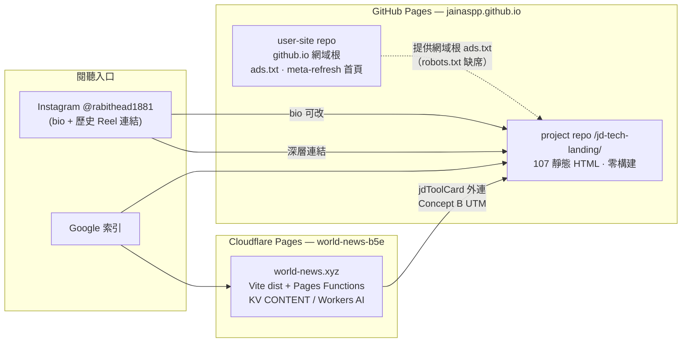
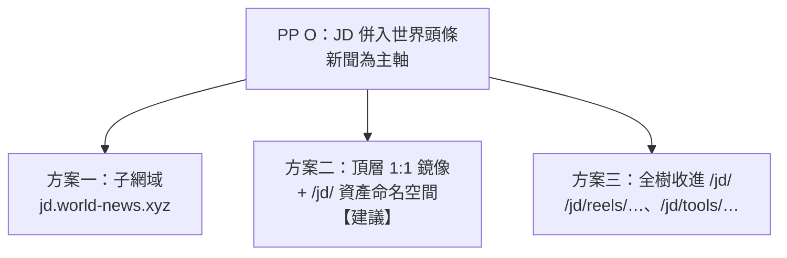
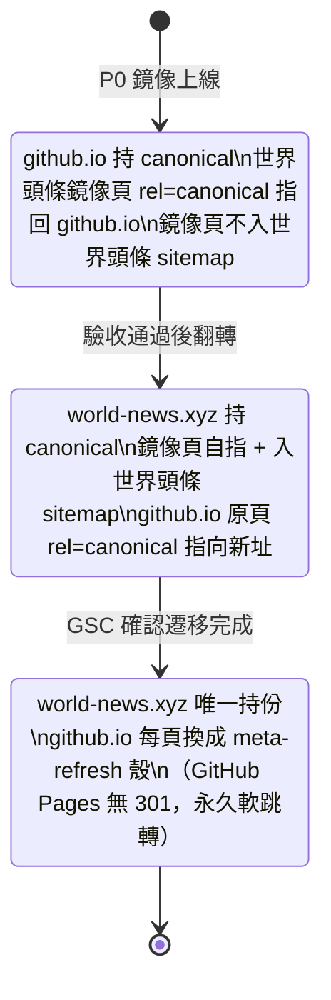
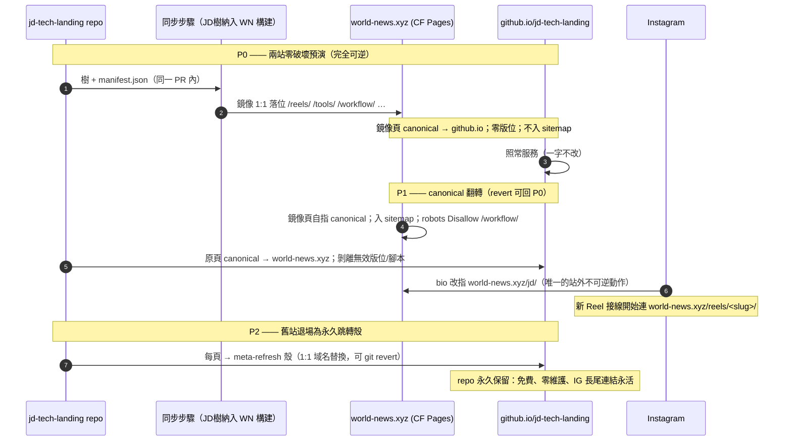
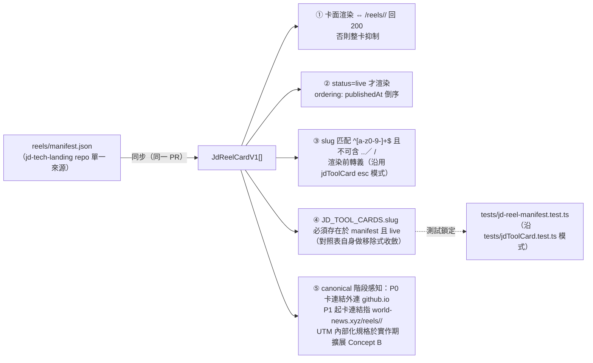

# JD Tech × 世界頭條合併研究（GLM 技術軸）

日期：2026-10-19 ｜ 立場文件（research only，無產品程式碼變更）
前置決策：**PP O 已定**——JD Tech 併入世界頭條，新聞為主軸。本文不討論「是否合併」，只研究「如何合併」。
分工：本文負責 GLM 被指派的四個軸：(1) 技術資訊架構——DNS、CF Pages 對 GitHub Pages、路徑設計（`/tools`、`/workflow`、`/reels` 鏡像）、sitemap／canonical／SEO；(2) 最少破壞的遷移順序；(3) AdSense 資產（兩處發佈版位對單一站點）在架構層的風險；(4) Reel 卡片納入世界頭條後的資料契約。

---

## 0. 結論摘要（先行）

1. **合併在技術上可行，且代價低於維持雙站。** 兩站同屬一位發佈商（`ca-pub-8392975944327076`），JD Tech 是純靜態、零構建、相對連結的 HTML 樹，天然適合被「掛載」到任何路徑前綴；世界頭條的 Cloudflare Pages 管線（Vite `dist` + Pages Functions + `_redirects`／`_headers`）具備承接整棵樹所需的一切能力。
2. **採用方案二：頂層一比一路徑鏡像 + `/jd/` 資產命名空間。** 觀眾可達頻道（`/reels/`、`/tools/`、`/workflow/`、`/learn/` 等十一個目錄）按原樣落位於 `world-news.xyz` 根層；JD 共用資產改置 `/jd/assets/`；`/about/`、`/privacy/` 併入世界頭條現有頁面，不重複維護政策頁。
3. **遷移槓桿是 canonical 編排，不是 DNS。** 推薦序列下，任何階段都不需要改動 DNS 記錄；GitHub Pages 因無法發出真正的 301，保留為「永久軟重定向殼」而非刪除站點。
4. **P0 全程可逆。** 第一階段只做「同步鏡像 + canonical 指回 github.io」：IG 連結、AdSense 站點審查狀態、既有索引全部不動；回滾等於刪除同步步驟。真正的不可逆動作（IG 簡介改連結、舊站頁面替換為跳轉殼）被推遲到 P1／P2，且每步均有 git 級回滾。
5. **AdSense 架構上的淨效果是降低風險。** 現況是「一個發佈商帳戶、兩個站點性質」：`world-news.xyz` 為已驗證主站，github.io 側的 `ads.txt` 依賴 **user-site repo（`jainaspp/jainaspp.github.io`）根目錄** 的副本才成立，屬於脆弱的人肉接線；且 JD 全部 107 頁無條件載入 `adsbygoogle.js` 但**無任何真實 `<ins>` 版位**。合併後廣告發佈集中於單一已驗證站點；鏡像須改用世界頭條現行的「有真實版位才載入腳本」契約。
6. **Reel 卡片資料契約以 manifest v1 為軸。** 單一事實來源放在 jd-tech-landing repo（reel 接線 PR 同步維護 `reels/manifest.json`）；世界頭條建立有型別、有版本、有不變式的解析層，延續 `shared/jdToolCard.ts` + `tests/jdToolCard.test.ts` 的既有測試鎖定模式。

---

## 1. 兩站技術現況（事實基礎）

### 1.1 世界頭條（主軸）—— world-news.xyz

| 項目 | 現況 |
| --- | --- |
| 託管 | Cloudflare Pages，專案 `world-news-b5e`（生產別名 `world-news-b5e.pages.dev`）；實測 `world-news.xyz` 經 Cloudflare 代理回 200 |
| 域名 | apex 為正名；`www` → apex 301（`functions/_middleware.ts`）；`*.pages.dev` 301 受 `REDIRECT_PAGES_DEV` 開關；preview 域名一律加 `x-robots-tag: noindex` |
| 構建 | Vite → `dist`；靜態資源由 `public/` 原樣複製；動態路由由 `functions/` Pages Functions 提供（`/digest/`、`/explainer/`、`/briefing/`、`/topic/`、`/analysis/`、`/civilization/`…） |
| 路由規則 | `public/_redirects`：僅 `/region/:code`、`/category/:slug` 200-rewrite 回 `/`；刻意**無** SPA catch-all，未知路徑走 `public/404.html` |
| 標頭 | `public/_headers`：全站安全標頭；`/assets/*` 一年 immutable（Vite hash 檔案專用）；`/ads.txt` 純文字 |
| Sitemap | `public/sitemap.xml` 靜態提供（實測 12,254 bytes），發佈時由 `writePublishedSitemap`（`functions/content/sitemapPublish.ts`）從 KV 索引重寫，隨下次部署生效；`SITEMAP_ORIGIN = https://world-news.xyz` |
| robots | 站根 robots.txt 真實生效（網域根 = 本站根）：`User-agent: * Allow: /`、`Mediapartners-Google Allow: /`、指回自家 sitemap |
| AdSense | `pub-8392975944327076`；站根 `ads.txt` 正確；**條件式載入**：僅當頁面存在真實 `<ins>`（版位 ID 已設定且該頁允許廣告）才出現 `adsbygoogle.js`；內文 500 字門檻、目錄頁與 `/region/twn` 不放廣告 |
| 雜訊控制 | `/region/twn` noindex 且不入 sitemap；薄稿／失敗殼不入索引；`omitSitemapLocs`／`blockedSitemapLoc` 有既有機制 |
| 既有 JD 整合 | `shared/jdToolCard.ts`：7 張 explainer↔reel 對照卡（`JD_TOOL_CARDS`），UTM 遵循 COMPANION-TRACKING-SPEC Concept B（`worldnews / referral / toolcard`），落於 `/explainer/<key>/` 來源列表上方，**外連** github.io reel 頁；`tests/jdToolCard.test.ts` 鎖定契約 |
| 既有路徑 | `/region/`、`/category/`、`/analysis/`、`/topic/`、`/digest/`、`/weekly/`、`/briefing/`、`/explainer/`、`/major/`、`/today/`、`/story/`、`/quiz`、`/search`、`/saved`、`/hk/`、`/civilization/`、`/data/`、**`/about/`、`/privacy/`**、`/terms/`、`/contact/`、`/on-this-day/`、`/feed.xml` |
| 遺存 | README 載明舊 Cloudflare Worker 已刪；Vercel 仍為鏡像（vercel.app → xyz 301）並**暫代每日 crawl cron**（08:00 UTC 打 `/api/crawl`），轉由 Pages cron 前維持現狀 |

### 1.2 JD Tech —— jainaspp.github.io/jd-tech-landing/

| 項目 | 現況 |
| --- | --- |
| 託管 | GitHub Pages 專案站：branch `main`、站根發佈、`.nojekyll`、零構建（純 HTML/CSS/JS）、無 CI workflows |
| 規模 | 107 個 HTML：`reels/` 60（59 slugs + 目錄）、`learn/` 11、`workflow/` 11（01–10 + 目錄）、`tools/` 11、`compare/` 3、`updates/` 2、七個單頁（about、beginner、play、privacy、prompt、prompt-builder、prompts-hk）、根 `index.html` + `404.html` |
| 路徑語義 | **相對連結貫穿全站**：深二層頁引用 `../../assets/style.css`，首層引用 `assets/style.css`——同棵樹掛在任何前綴下相對連結仍然成立；canonical／OG／JSON-LD／sitemap 則**絕對 URL 硬編至 github.io 專案路徑** |
| 資產 | `assets/`（style.css、og-share.png、favicon 系列等）由所有層級分享 |
| 粉絲閘 | `workflow/01…10` 以 StatiCrypt（AES-CBC）客戶端解密，密碼 `jdtech3` 在頁面明示；全區 `meta robots noindex, nofollow`，不在 sitemap；repo `robots.txt` 同時寫了專案前綴與根前綴兩組 `Disallow` |
| robots 實效 | GitHub 專案站的 robots.txt **不在網域根**——實測 `https://jainaspp.github.io/robots.txt` 為 GitHub 404 頁；即現況 `/workflow/` 的 `Disallow` 寫在 repo 內**實際上無爬蟲效力**，唯一保護是頁面自身的 noindex meta |
| ads.txt | 網域根 `https://jainaspp.github.io/ads.txt` 實測 200 回正確內容——由 **user-site repo `jainaspp/jainaspp.github.io`** 維護（其站根即為 github.io 網域根；站根頁為 meta-refresh 轉址到專案站）。JD 側 ads.txt 的存量效力**完全依賴這個 user-site repo** |
| 廣告現況 | 全部 107 頁無條件載入 `adsbygoogle.js?client=ca-pub-8392975944327076`，但**全站無任何一個真實 `<ins data-ad-slot>`**——腳本載入即止，無實際版位發生 |
| 搜尋驗證 | 各頁帶 `google-site-verification` meta（`XMnJBOlOUXgDXQ6gmQRlYCLN38NapRxzaWI72DuWeeQ`） |
| 外部掛鉤 | Instagram @rabithead1881（IG bio 為主要入口、歷史 Reel 連結永久指向 github.io 深層頁）；Gumroad 兩個產品連結；`latest-reels:start/end` HTML 註解標記供首頁兩條最新 Reel 區段注入 |
| 更新機制 | 無 CI——由「reels: wire Ep.N … to live Reel `<id>`」形式的 PR 逐條接線（git log 實證，最近至 Ep.40） |

### 1.3 現況服務拓撲



---

## 2. 資訊架構：路徑設計（`/tools`、`/workflow`、`/reels` 鏡像）

### 2.1 落位碰撞矩陣

把 JD 樹原樣掛到 `world-news.xyz` 根層時，逐目錄盤點：

```
JD 目錄           world-news.xyz 根層態          判定
--------------    ----------------------------------   ----------
/ (JD hub)        根 index.html = 新聞主頁殼       ✗ 碰撞 → 頻道頁另立（見 2.3）
/about/           functions/about/ 已存在          ✗ 碰撞 → 併入世界頭條關於頁
/privacy/         functions/privacy/ 已存在        ✗ 碰撞 → 併入世界頭條私隱頁
assets/*          /assets/ = Vite hash 構建輸出     ✗ 碰撞（含 _headers 一年
                                                   immutable 快取語義衝突）
                                                   → 遷至 /jd/assets/
/404.html         public/404.html 已存在           ✗ 語義碰撞 → 不鏡射
/tools/           未佔用                          ✓ 原樣落位
/workflow/        未佔用                          ✓ 原樣落位
/reels/           未佔用                          ✓ 原樣落位
/learn/           未佔用                          ✓ 原樣落位
/compare/         未佔用（/explainer/ 為不同語義）  ✓ 原樣落位
/beginner/        未佔用                          ✓ 原樣落位
/prompt/           未佔用                         ✓ 原樣落位
/prompt-builder/  未佔用                          ✓ 原樣落位
/prompts-hk/      未佔用                          ✓ 原樣落位
/updates/         未佔用                          ✓ 原樣落位
/play/            未佔用                          ✓ 原樣落位
```

結論：**11 個內容頻道可以 1:1 原樣落位**；三個策略性衝突（根路徑、about/privacy、assets）各有明確解法。`/about/`、`/privacy/` 併入世界頭條現有頁非但不是損失，反而對 AdSense 政策與 GSC 單一化有利（一個站一份政策頁）。

### 2.2 三個方案



| 軸向 | 方案一（子網域） | **方案二（頂層鏡像）【建議】** | 方案三（`/jd/` 命名空間） |
| --- | --- | --- | --- |
| DNS 動作 | 需新增記錄 + Pages custom domain + middleware 按 host 分流 | **零 DNS 變更** | 零 DNS 變更 |
| SEO 權重 | 分裂於新主機名；等於把「合併」降級為「搬家」 | 集中於 `world-news.xyz` 單一 host | 集中，但多一層路徑 |
| 與既有 IA 語義 | 新聞域下掛獨立站，違 PP O 的主軸精神 | 教學內容成為平台頻道，主軸成立 | 同左，但「jd」前綴將自創產品名寫進 URL，日後品牌演進受縛 |
| 深層連結連續性 | 路徑保持，但網域全新；IG 舊連結兩者皆救不回（見 §4 說明） | 同上；舊→新靠 github.io 端軟跳轉殼，1:1 路徑使殼零翻譯 | 殼需逐頁改寫路徑前綴 |
| 衝突處理 | 天然隔離 | 需處理 §2.1 三項（均有解） | 天然隔離 |
| 未來留白 | 佔用子網域 | `/reels/`、`/tools/` 為頻道級通用名，日後可承載站級功能 | 根層留白 |

**建議：方案二。**理由：PP O 的「新聞為主軸」要求教學內容成為世界頭條的頻道而非平行站點；1:1 路徑把 P2 的跳轉殼簡化成逐頁 meta-refresh 而免路徑翻譯；11 個頻道級通用名（tools／reels／workflow…）在合併後屬於「平台資產」而非「JD 專屬」，值得放在根層。方案一以 DNS 隔離換取零衝突，但代價是權重分裂與多一層 middleware 複雜度，與「合併」目標矛盾；方案三最保守，僅在方案二的衝突解法被否決時採用。

> 說明：IG 已發佈的 Reel caption／DM 深層連結指向 `github.io/jd-tech-landing/...`，任何方案都無法改寫歷史貼文。路徑連續性的真正受益者是「跳轉殼的簡潔度」與未來連結的穩定語義，而非舊貼文。

### 2.3 建議的最終路徑圖（方案二展開）

```
world-news.xyz（新聞主軸，不動）
├── /                      新聞首頁（Vite 殼，現狀）
├── /jd/                   ★新增：JD Tech 頻道樞紐頁
│                            （JD 根 index.html 的內容改編：Reels 區塊、
│                              教學入口、Workflow 卡、Gumroad 卡、IG CTA）
├── /reels/                ★鏡像：目錄 + 59 個 /reels/<slug>/
├── /tools/                ★鏡像：目錄 + 10 個工具頁（/tools/chatgpt/ 等）
├── /workflow/             ★鏡像：01–10 + 目錄（StatiCrypt 檔案原樣，閘不變）
├── /learn/  /compare/  /beginner/  /prompt/  /prompt-builder/
│   /prompts-hk/  /updates/  /play/        ★鏡像（同構）
├── /jd/assets/            ★JD 共用資產新居（style.css、og-share.png、favicon…）
├── /about/  /privacy/     世界頭條既有頁，內容增補 JD Tech 說明後合併敘述
└── （其餘新聞路徑一律不動）
```

配套（屬實作細節，僅記錄約束）：

- `public/_headers` 需為 `/jd/assets/*` 另立快取規則（短 TTL，**不可**沿用 `/assets/*` 的 immutable 一年——JD 資產無 hash 檔名，一年 immutable 會把改稿鎖死在 CDN）。
- 同步步驟須重寫三類絕對引用：`rel=canonical`、`og:url`／`og:image` 等 OG／Twitter 標籤、JSON-LD `url`；並剝離 `google-site-verification` meta（避免把 `world-news.xyz` 附進 JD 的 GSC 驗證殼）與 JD 的 `adsbygoogle.js` 無條件載入（改用世界頭條條件式契約，見 §5）。
- `robots.txt`（站根，真實生效）增列 `Disallow: /workflow/`——JD 側這行寫了多年但受制於 GitHub 專案站無法置於網域根；併入 `world-news.xyz` 後**首次真正生效**，屬淨改善。

---

## 3. DNS 與主機層：Cloudflare Pages 對 GitHub Pages

### 3.1 能力對照

| 能力 | CF Pages（world-news） | GitHub Pages（jd-tech） | 對合併的含義 |
| --- | --- | --- | --- |
| 網域根 robots.txt / ads.txt | 站根即網域根，真實生效 | 需 user-site repo 代持（現況正是如此） | 合併後單一權威 |
| Host 級 301 | middleware 可按 host 轉 | 不支援 | www/apex 收斂經 CF 完成 |
| Path 級 301／rewrite | `_redirects`／middleware | 僅 meta-refresh、404 頁 | **遷出**的方向可行；**遷入** GH 無法做硬跳轉 |
| 回應標頭 | `_headers` 全控 | 不可控 | 安全標頭與快取語義靠 CF |
| 邊緣運算 | Pages Functions、KV、Workers AI | 靜態 | manifest 解析、卡片渲染可上邊緣 |
| Ads/robots 之外的審查面 | Cloudflare 代理、自訂網域 | github.io 共享網域 | AdSense 站點驗證以自有網域為正 |
| 維運成本 | 現有管線（`npx wrangler pages deploy dist`） | 零構建、免費、可永久閒置 | **GH Pages 保留為免費永久跳轉殼** |

### 3.2 DNS 決策

**推薦序列下 DNS 全程零變更。**`world-news.xyz` 已指向 Cloudflare Pages（實測 `server: cloudflare`）；方案二僅在同一 host 下新增路徑，不觸發任何記錄變更、無 TTL 窗口、無傳播風險——這是「最少破壞」的第一塊基石。唯一會動 DNS 的分岔是方案一（子網域），故不建議。另一個 DNS 課題記錄在案：README 載明每日 crawl 仍由 Vercel Cron 代打，此為現存債務，與本次合併正交，遷移期間**維持原樣**，避免兩件事的變數疊加。

---

## 4. Sitemap / Canonical / SEO 編排

### 4.1 鐵律：canonical 所有權狀態機

兩站同內容共存期間，最常見的失敗是雙方同時自指 canonical。本序列以「每一個 URL 在任一時刻只能有一個 host 持有 canonical 所有權；sitemap 只列自持頁」為不變式：



### 4.2 各階段的 sitemap 與 robots 設置

| 階段 | world-news.xyz/sitemap.xml | github.io …/jd-tech-landing/sitemap.xml | robots |
| --- | --- | --- | --- |
| P0 | **不含**任何 JD 鏡像路徑（現有 `staticSitemapUrls`／發佈時路徑均不動） | 照舊為權威列表 | 世界頭條 robots 增 `Disallow: /workflow/`；JD 側不動 |
| P1 | 加入鏡像目錄與可索引內頁（目錄 11 頁 + reels/tools/learn/compare 深頁，規模約百餘 URL，sitemap 遠在 50MB 上限內）；沿用既有 hub/深頁優先級習慣（0.7–0.85） | 移除列表（保留檔案但置空或改列殼頁）；`Sitemap:` 行改指 world-news.xyz sitemap | 兩側 `Disallow: /workflow/` 並存 |
| P2 | 同 P1 | 檔案縮至殼頁（殼頁本身留 noindex，不構成索引面） | GitHub 網域根缺 robots 維持不變，風險歸零（不再有可索引頁） |

技術基礎已齊備：世界頭條 sitemap 的生成是「`public/sitemap.xml` 靜態檔 + 發佈時 `writePublishedSitemap` 重寫 + 下次部署生效」三段式，新增一批靜態路徑只需擴充 `staticSitemapUrls()` 一處；不走 Pages Function 動態 sitemap，與現行架構一致。

### 4.3 GitHub Pages 的 301 缺口與補償

- GitHub Pages 無法發出目錄級／頁級 301。P0→P1 靠**雙向 canonical**教 Google 合併信号；P2 靠 meta-refresh 殼（`content="0;url=…"`）承接人類訪客與 IG 長尾。這是靜態宿主下的標準補償，非本專案特有缺口。
- 1:1 路徑（方案二）使殼頁的 URL 映射是純網域替換，可由同步腳本機械生成，無路徑翻譯錯誤面。
- 風險承接：GH 側 repo robots.txt 雖在網域根無效，但 P2 後 github.io 已無站點收錄需求，此缺口自然消解（不新增 user-site robots——那會影響 github.io 網域根下他人專案的認知邊界，超出本專案職責，明確不做）。

---

## 5. AdSense 資產風險（架構層）

> 範圍聲明：本節僅討論**架構與版位配置層**的風險結構，不涉及 AdSense 主控台操作、支付、個別版位 ID 或重新審查流程。

### 5.1 事實重構：「兩處版位對單一站點」的實相

實測兩站共使**同一** publisher：`ca-pub-8392975944327076`（兩站 ads.txt 同款，`DIRECT, f08c47fec0942fa0`）。故命題應精確化為：**一個發佈商帳戶、兩個站點性質**——`world-news.xyz`（自有網域、已走條件式載入與內容門檻）對 github.io 側（依賴 user-site repo 代持網域根 ads.txt 的共享網域）。兩站即使 UI 完全互不相干，在發佈商層面一直是同一現金流。

### 5.2 架構層風險登記表

| # | 風險 | 現況基礎 | 合併方向下的處置 |
| --- | --- | --- | --- |
| A1 | github.io 側 ads.txt 依賴 user-site repo 根目錄副本；該 repo 一旦改名／刪除，github.io host 的 authorized sellers 宣告即失效 | 實測 200 依賴 `jainaspp.github.io` repo | P0–P1 期間**凍結**該 repo（P2 之前不動）；最終 github.io 停止出現真實版位後失義 |
| A2 | JD 107 頁無條件載入 `adsbygoogle.js` 而無任何 `<ins>` 版位 | 實測 0 個 `data-ad-slot` | 鏡像時即改用世界頭條契約：**無真實版位 → 不載入腳本**。同步世界頭條既有「不打假版位」的審查紀律 |
| A3 | `／workflow/` 客戶端解密、密碼明示、noindex——若掛廣告屬低價值＋政策灰區 | 現況無 `<ins>`，風險未兌現 | 鏡像層**明確零版位**並以 robots Disallow＋noindex 三重鎖（併入站根 robots 後 `Disallow` 首次真實生效） |
| A4 | 共存期同一內容兩 host 皆可能渲染廣告，稀釋單頁價值 | 現況 JD 無版位，不成立 | 維持「**非 canonical 副本零版位**」為架構規則：P0 github.io 持 canonical、鏡像頁零版位；P1 翻轉後 github.io 原頁零版位（A2 一併解決） |
| A5 | 站點性質：`world-news.xyz` 從純新聞加入教學／帶 Gumroad 付費連結內容，站點內容結構改變 | 世界頭條已過站級審查 | 分批收錄緩衝內容結構變化：P0 不入 sitemap、P1 分頻道收錄；教學長文（多數頁中文內容充實）與世界頭條現行 500 字門檻同向 |
| A6 | 發佈商層「兩站點性質對一個站點性質」的帳戶結構差異 | — | 純主控台層動作（P2 之後退役 github.io 站點性質），**本文件僅標記時點**：github.io 最後一個真實版位消失後才退役；不屬於程式碼變更 |

### 5.3 合併的淨效果

 方向上，A1–A5 每一項在 P1 後都**收窄**而非擴大：品牌集中到一個已驗證自有網域、條件式載入契約統一、root ads.txt 與 root robots 均真實生效、版位零重複。唯一新增的注意項是 A5 的站點內容結構改變，用「分批入 sitemap」對沖。**結論：以 AdSense 架構論，合併是淨減險；風險集中在遷移的共存期，且全部屬「不做某事」型（零版位、凍結 user-site repo），實作成本極低。**

---

## 6. 最少破壞遷移序列

設計原則：(i) 每一步都有 git 級回滾；(ii) 不可逆動作（改 IG bio、替殼）後置；(iii) 兩站在 P2 之前**永遠同時全量在線**；(iv) 任何時刻 canonical 所有權唯一（§4.1）。



### 6.1 階段表與回滾

| 階段 | 動作 | 對外部世界的影響 | 回滾 |
| --- | --- | --- | --- |
| **P0** | 同步步驟把 JD 樹（含 §2.3 三類絕對引用改寫）併入世界頭條構建；鏡像頁 rel=canonical 指回 github.io；零版位；不入 world-news sitemap；robots 增 `Disallow: /workflow/`；`/jd/` 樞紐頁上線；若需要，世界頭條首頁技術頻道插 reel 卡（資料契約見 §7，連結仍外連 github.io） | 零：github.io 一字未改；IG 未改；索引未改；搜尋者可在 SERP 外先行訪問新頁 | 刪除同步步驟 + revert 單一 PR |
| **P1** | 兩側 canonical 互換（world-news 鏡像自指並入 sitemap／Og 對齊；github.io 原頁改指新址）；IG bio 換連結；新 reel 接線改往新域 | Google 開始把 github.io 的 URL 信號併入 world-news.xyz；IG 新流量走新域 | revert 兩個 repo 的各一個 PR；IG bio 改回（站外動作，可再改） |
| **P2** | GSC 確認遷移後，github.io 每頁換 meta-refresh 殼（內容移除、跳轉保留）；JD 側 sitemap 置空 | 人類長尾流量經殼到新址；github.io 出索引面 | git revert 殼 PR；回 P1 態 |

### 6.2 順序的理由（為何這樣排）

1. **先共存、後翻轉、再退場**：P0 的鏡像是「免費預演」——部署、渲染、快取、條件式廣告契約、卡片契約全部在真實環境驗證，而任何 Stakeholder 面都零變化。
2. **`/workflow/` 與 ads.txt 是兩個隱形雷**：前者現況的 robots 保護其實無效（§1.2），後者懸在 user-site repo 上（§5.2 A1）。P0 一併把兩者轉入安全態：站根 robots 真實生效、user-site repo 凍結。
3. **IG bio 是唯一不完全受 git 管轄的資產**，故排在 P1 尾、且緊跟著它仍可 revert 的窗口。
4. **Vercel cron 與本遷移正交**，期間明確不動，故障平面分離。
5. GH Pages 刪站是**不必要的破壞**：免費、零維護、IG 長尾永活——「最少破壞」的最佳註腳是連刪除本身都不做，只做殼化。

---

## 7. 資料契約：Reel 卡片納入世界頭條（v1）

### 7.1 現況與目標態

現況：`shared/jdToolCard.ts` 靜態列舉 7 組 explainer↔reel 對照，卡片**外連** github.io reel 頁，UTM 為 Concept B；`tests/jdToolCard.test.ts` 鎖定。若 reel 卡片要在世界頭條首頁／頻道頁渲染（PP O 的可見收益之一），需引入可演進的資料契約，而非繼續手寫陣列。

### 7.2 事實來源與同步管道

**事實來源單一：jd-tech-landing repo 的 `reels/manifest.json`**，由既有「reels: wire Ep.N … to live Reel」PR 流程在同一 PR 內維護（git log 證明該流程穩定日更）。世界頭條側取用二選一：

| 管道 | 機制 | 取捨 |
| --- | --- | --- |
| **A：repo 內固化（建議 v1 採用）** |Manifest 與頁面同樹進入世界頭條構建（同步步驟一併帶入）；渲染在建時／邊緣讀構建產物或 KV 預寫 | 單一 PR ⇒ 單一部署，頁與卡天然原子一致；零新 secret；延遲 = 一個部署（併入既有日更步） |
| B：KV 推送 | JD repo 的 GitHub Action 以 secret POST 到世界頭條 API，寫 KV | 卡片可先於鏡像頁更新；但新增 secret、端點、最終一致性處理，v1 不值 |

### 7.3 Schema v1（提案形態）

```ts
interface JdReelCardV1 {
  schema: 1;                    // 版本釘死；向後兼容 = 只增必填為可選欄位
  slug: string;                 // kebab-case；一經發布即凍結 = /reels/<slug>/ 路徑
  ep: number | null;           // IG 集數（無則 null）
  title: string;                // 繁中標題，建議 ≤ 40 字（卡面單行）
  deck: string;                 // 導語一行（沿用「今朝實測｜追蹤日更」語式）
  igReelUrl: string;            // https://www.instagram.com/rabithead1881/reel/<id>/
  publishedAt: string;          // ISO 8601（香港時區錨定）
  tools: string[];               // 相關工具頁 slug，對應 /tools/<slug>/，可為空陣列
  status: 'live' | 'draft';     // draft 卡一律不渲染
  sha: string;                  // 來源 commit 短雜湊，追溯用
}
```

### 7.4 不變式（契約的骨）



1. **可用性優先**：卡片是「承諾」，渲染即承諾目標頁存在；manifest 與鏡像頁同 PR 部署（管道 A）令此不變式近乎免費，仍以渲染層校驗兜底。
2. **漸進相容**：rights of manifest 屬 JD repo；世界頭條只讀。schema 以「只加可選欄位」演化，破壞變更升 `schema: 2` 並保留 v1 解析器一個過渡期。
3. **與 JD_TOOL_CARDS 的關係**：對照表續為「哪個 explainer 出卡」的權威；manifest 是卡片資料與全量 reel 註冊表的權威；交集由不變式 ④ + 測試雙鎖。
4. **審計面**：`sha` 欄位 + 兩 repo 的 PR 鏈接提供「哪一條 reel 由哪次接線引入」的完整回溯，與現有 git log 習慣連續。

### 7.5 延遲與一致性（管道 A 下的量化）

JD 侧日更 PR（07:00／12:00 HKT 後例行）→ 同步 PR → world-news 部署（`npm run build` + wrangler pages deploy，分鐘級）。卡片落後 reel 頁面 1 個部署週期；因兩者在同一部署內原子上線，**不存在「卡有而頁無」中間態**——這是 v1 選管道 A 的決定性理由。

---

## 8. P0 可逆性核對清單

P0 的每一次改動及其回滾面：

| # | P0 動作 | 回滾方式 | 影響外部？ |
| --- | --- | --- | --- |
| 1 | 同步步驟納入 JD 樹（／jd/ 樞紐、11 頻道鏡像、／jd/assets/） | 刪同步步驟，回滾一個 PR | 否：新 URL 前綴，無人依賴 |
| 2 | 三類絕對引用改寫（canonical/OG/JSON-LD）+ 剝 verification meta 與無效腳本 | 同上（同步步驟屬性） | 否 |
| 3 | 鏡像頁零版位、不入 world-news sitemap | 同上 | 否 |
| 4 | robots.txt 增 `Disallow: /workflow/` | revert 行 | 極小：僅屏蔽本就 noindex 的解密區 |
| 5 | GitHub 側一字不改、IG 不改、user-site repo 凍結 | 無動作 | 否 |
| 6 | 若插首頁／頻道 reel 卡：manifest + 解析層 | revert 觀察面 PR；資料層無副作用 | 卡面僅新增導流行為 |

**P0 之後的兩個 PR 是全序列中唯一需要決策會簽的閘門**：P1 的兩 repo canonical 翻轉，與 IG bio 修改。其餘一切均在「刪同步即回原樣」的範圍內。

---

## 9. 風險、未定事項與非目標

- **未定事項（超出本文件職權，實作期決策）**：`/jd/` 樞紐頁的資訊設計與和新聞首頁的導航融合；UTM 內部化後的 Concept B 延伸規格；Pages cron 接手 crawl 的時點；GSC 帳戶側操作。
- **明確非目標**：任何產品程式碼變更（本 PR 僅本文檔）；AdSense 主控台操作指引；GH 側 user-site repo 的增補（robots 等）；刪站（P2 僅殼化不刪除）。
- **依賴確認（已實測核對）**：兩站 pub 同源；JD 樹相對連結自洽；`world-news.xyz` 經 CF 代理；github.io 網域根 ads.txt 200／robots 404；JD 全站零 `<ins>`；工作流 noindex 三重鎖（meta noindex,nofollow + sitemap 排除 + repo robots 記載）。

## 附錄：事實出處

| 事實 | 出處 |
| --- | --- |
| CF Pages 專案／www→apex／preview noindex／REDIRECT_PAGES_DEV | `wrangler.toml`、`functions/_middleware.ts`、`public/_redirects` 註解 |
| sitemap 三段式機制、SITEMAP_ORIGIN | `shared/sitemap.ts`、`functions/content/sitemapPublish.ts`、`public/sitemap.xml` |
| 條件式 adsbygoogle 契約、ads.txt、500 字門檻、/region/twn 處置 | repo `README.md`（段落：環境變數、版位規則、Cloudflare Pages） |
| 既有 JD 卡片及其測試鎖定 | `shared/jdToolCard.ts`、`tests/jdToolCard.test.ts`、`shared/contentPage.ts`（`jdToolCardMarkup` 調用點） |
| `/about/`、`/privacy/` 既有路徑 | `functions/about/index.ts`、`functions/privacy/index.ts` |
| `_headers` 快取語義 | `public/_headers`（`/assets/*` 一年 immutable） |
| JD 樹零構建、相對連結、頁面清單與規模 | `jainaspp/jd-tech-landing` checkout（107 HTML；git log 至 2026-10-19）；`README.md` |
| JD canonical/OG/sitemap 硬編 github.io 絕對 URL | `index.html`、`tools/index.html`、`reels/3ai-mold-clothes/index.html`、`sitemap.xml` |
| workflow StatiCrypt + noindex | `workflow/index.html`、`workflow/05/index.html` |
| 網域根 ads.txt 200／robots 404／根首頁 meta-refresh | 實測 `https://jainaspp.github.io/ads.txt`、`/robots.txt`、`/`；user-site repo `jainaspp/jainaspp.github.io` 存在性（`git ls-remote`） |
| JD 全站無 `<ins>` 版位實測 | `grep '<ins' --include=*.html` 全樹零命中；`adsbygoogle.js` 107 頁命中 |
| 兩站線上服務態 | `curl -sI https://world-news.xyz/`（`server: cloudflare`）、`curl -sI https://jainaspp.github.io/jd-tech-landing/`（GitHub.com，max-age=600） |

—— GLM（技術軸）research，2026-10-19；本文件不構成任何程式碼變更。